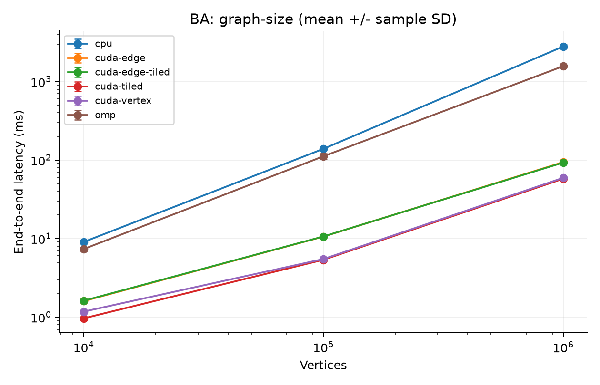
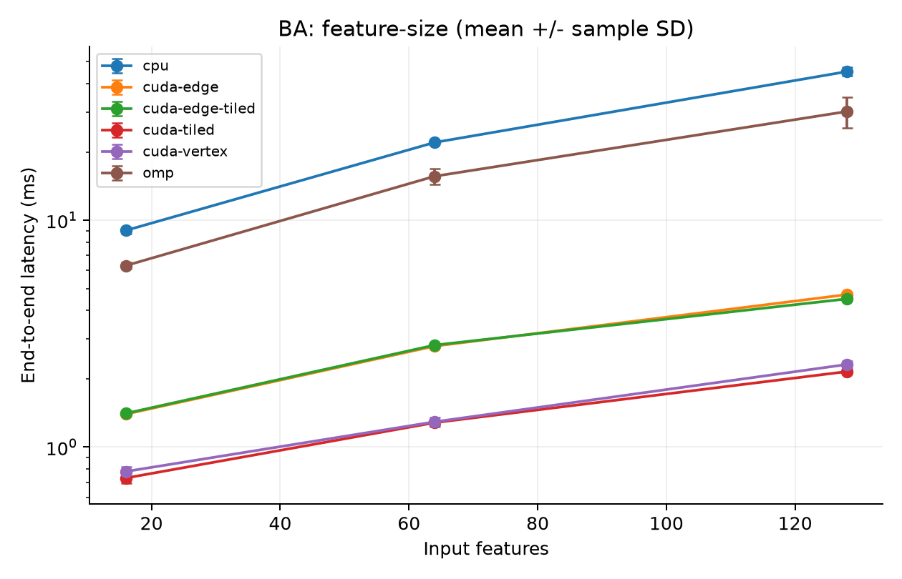
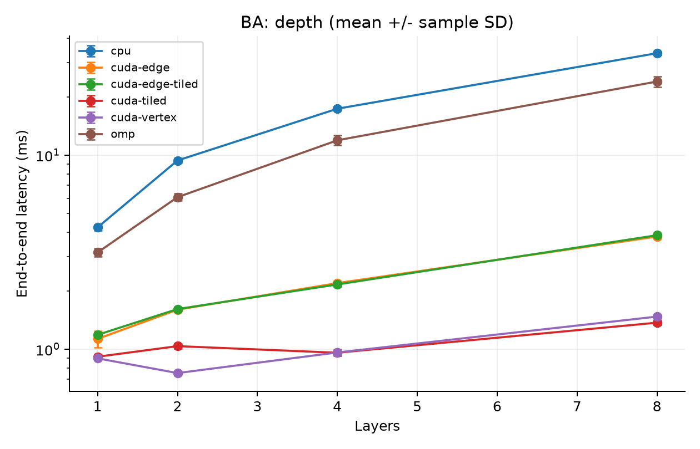
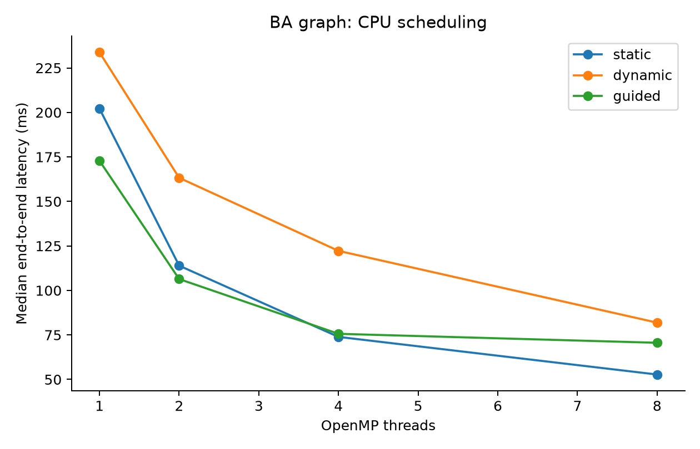
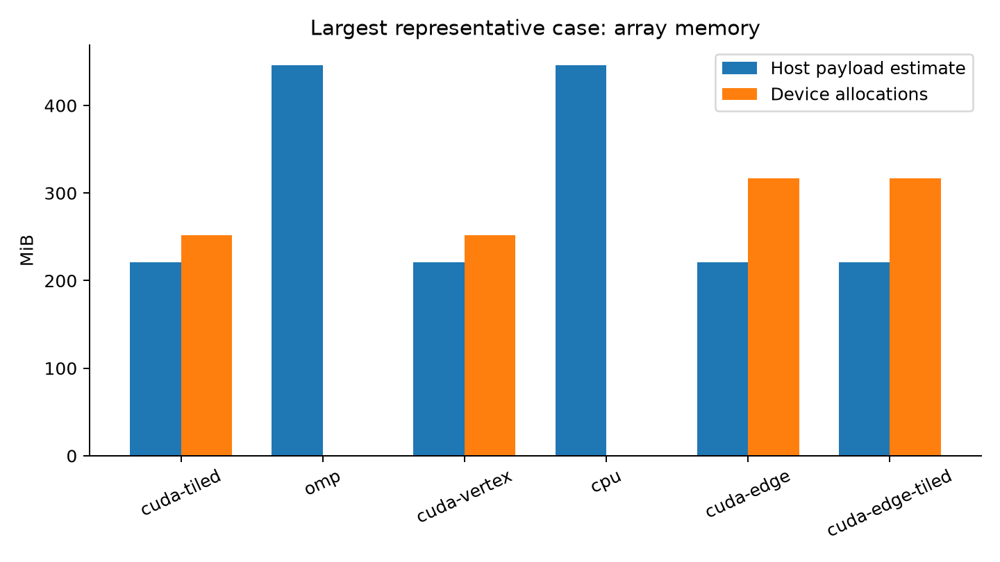

# Project Q1: Graph Neural Network Inference on GPUs

## Scope and model

This project implements full-batch inference on one static graph. The model
is a stack of GCN-style message-passing layers with fixed FP32 weights:

`A_l[v,f] = sum_(u in incoming(v)) s(v,u) H_l[u,f]`

`H_(l+1) = activation(A_l W_l)`.

The selectable scaling is 1 for sum, `1/degree(v)` for mean, and
`1/sqrt(degree(v)*degree(u))` for symmetric normalization. For symmetric mode,
a zero-degree neighbor contributes zero. Degrees are CSR row degrees. This
definition on directed graphs is explicit; the public experiments make the
graphs undirected so that the usual symmetric interpretation applies.
An isolated node has a zero aggregate. Hidden layers use ReLU and generated
models use Identity in the final layer, yielding logits/embeddings. No bias,
self-loop insertion, training or softmax is implicit. Classification accuracy
is not reported for generated weights. A supplied `.gnnimodel` can hold
pretrained weights with the same layer semantics.

One architecture meets the Q1 requirement of one or two. GraphSAGE, attention,
training and multi-GPU execution are outside this implementation's scope.

## Data and integration

The shared dataset is GNNIDAT1: versioned little-endian CSR plus dense FP32
features, with optional labels and splits. Rows are destinations and columns
are incoming sources. Loader checks cover sizes, bounds, sorted unique
neighbors, finite features and metadata consistency. The format stores
64-bit row offsets but current common/CUDA arrays use signed 32-bit indices,
so vertices and CSR entries must not exceed INT_MAX. This still permits the
million-node experiments, but does not support arbitrarily large OGB graphs.

The existing CPU implementation has wider offsets and its own legacy file
format. Its types were moved to `gnni_cpu` to prevent same-name C++ type and
symbol collisions with common/CUDA `gnni`. `integration/engine.cpp` adapts
the shared graph and model once at setup. CPU file-loader restrictions such
as rejecting self-loops remain limited to the legacy file interface; the
integrated in-memory CPU path preserves the shared graph's explicit loops.

The unified CLI gives each backend the same graph, features, layer weights,
activations and normalization. Weight generation uses an explicit 32-bit
linear congruential sequence and a width-dependent scale. Generated weights
are initialized before setup and remain fixed during measurement. The seed,
layer widths, dataset hashes and executable hash accompany the results.

## CPU implementation

The sequential backend is the correctness reference. Each row aggregates
neighbor features and performs a dense transform. OpenMP assigns rows to
workers. Static scheduling has low scheduling overhead; dynamic and guided
scheduling can distribute highly skewed degrees more evenly. No aggregation
atomics are needed because each row has a single CPU owner.

The OpenMP dense loop traverses output features contiguously for weight and
output locality. Consequently CPU-vs-OpenMP speedup includes this loop-order
improvement as well as parallel execution; the one-thread OpenMP measurements
help distinguish these effects. OpenMP scheduling uses explicit loop clauses
instead of newer runtime scheduling functions, supporting MSVC's older
OpenMP runtime. Input and model shapes are checked before indexing.

## CUDA mappings and memory

| Unified backend | Aggregation | Dense transform |
|---|---|---|
| cuda-vertex | One `(vertex,feature)` output per thread | One `(vertex,output feature)` output per thread |
| cuda-tiled | Same vertex-feature aggregation | 16x16 shared-memory tiling |
| cuda-edge | One `(edge,feature)` contribution per thread, atomic accumulation | Baseline dense transform |
| cuda-edge-tiled | Edge-feature aggregation | 16x16 shared-memory tiling |

This 2x2 comparison separates the effect of aggregation mapping from shared
memory in the dense stage. The baseline already coalesces accesses across
adjacent features, although irregular neighbor indices limit locality.
Edge parallelism distributes long rows across threads and may improve degree
imbalance. Its costs are atomic contention, zeroing the aggregate buffer,
an additional E-entry destination array and nondeterministic summation order.
It is an alternative to evaluate, not an assumed speedup.

Tiled dense multiplication reuses feature and weight tiles across 256 threads.
All threads participate in barriers, including boundary tiles. Grid-stride
tile loops support graphs exceeding 65,535 row tiles. The integration tests
cover nonmultiples of 16, isolated vertices, skewed rows and multiple layers.

A CUDA context uploads CSR once. Device feature ping-pong buffers retain
intermediate layers, so only the initial features and packed weights enter
the GPU per call and only the final output returns. RAII owns device buffers,
events and the stream. Buffers retain capacity for repeated calls. Kernels
check launch errors; the synchronized output boundary detects execution errors.

Memory scales approximately as `4*(N+1+E) + 12*N*Fmax + 4*weight_count`
bytes on device, with an extra `4*E` for edge mapping. Capacity, not just
logical sizes, is reported. Host memory reports estimated live array payloads
including the retained input dataset/model, adapters and temporary matrices.
It excludes allocator overhead, OS RSS and CUDA driver/context allocations.
It is not a measurement of total process memory. Verification's temporary
reference output is outside the reported measured-call footprint.

Sparse CSR is used for the adjacency and dense storage for features/weights.
A dense FP32 adjacency for one million nodes alone would require 4 TB, so
dense adjacency and feature compression are not implemented. This tradeoff
is documented instead of presenting an unperformed comparison.

## Correctness and portability

`--verify` executes the real sequential CPU backend and the requested backend
on identical inputs before timing. The comparator requires matching shapes,
finite values and `abs(error) <= 1e-5 + 1e-4*abs(reference)` per element.
Small literal fixtures additionally test the CPU calculation independently.
Atomic results can vary in low bits; a failed tolerance check aborts the
experiment instead of producing a successful result row.

CTest covers the existing modules and the unified API/CLI. The combined
test iterates over every compiled backend and sum/mean/symmetric modes,
uses different OpenMP schedules, checks 19/33/17/7 feature widths, three-layer
context reuse, directed graphs, explicit loops, zero edges and invalid shapes.

Windows dataset writes use exclusive temporary files and atomic installation
via MoveFileExW; Linux keeps renameat2 with RENAME_NOREPLACE. General dataset
round-trip and corruption tests run on both. Linux-specific syscall-hook and
symlink tests remain Linux-only. They have not been re-executed on this Windows
machine. See docs/VALIDATION.md for the actual run record.

## Experimental method

`experiments/run_experiments.py` runs a declared matrix and writes one CSV row
per measured call. Each configuration uses two warmups and seven measured
runs by default, with correctness checked first. Backend ordering is shuffled
with a fixed seed to reduce a fixed execution-order bias. Runs are sequential,
not simultaneous CPU/GPU stress tests. Short sample counts and laptop thermal
variation limit claims; the exported plots show sample standard deviation.

| Dimension | Configurations |
|---|---|
| Graph families | Erdos-Renyi, Barabasi-Albert, Watts-Strogatz |
| Graph size | 10,000; 100,000; 1,000,000 vertices |
| Input features | 16, 64, 128 on BA-10k |
| Depth | 1, 2, 4, 8 on BA-10k |
| CPU scaling | 1, 2, 4, 8 threads and static/dynamic/guided on BA-100k |
| Public graphs | Cora and ogbn-arxiv, symmetrized with explicit self-loops |
| Implementations | Sequential, OpenMP, four CUDA configurations |

The graph-size sweep fixes input width 16 and layer widths 16,8. The
feature-size sweep changes only input width; the depth sweep repeats hidden
width 16 with final width 8. These are controlled slices, not a Cartesian
product over all dimensions. ER uses average degree 16, BA adds eight edges
per arriving vertex, and WS uses 16 ring neighbors and rewiring probability
0.1. Degree counts include explicit self-loops and both CSR directions for
undirected edges. CSV includes maximum degree and degree coefficient of
variation for interpreting load imbalance.

### Timing contract

- `load_ms`: dataset load and generated/supplied model preparation.
- `setup_ms`: validation, host adaptation, context creation and static upload.
- `graph_h2d_ms`: one-time CUDA-event static graph upload, also part of setup.
- `end_to_end_ms`: complete backend inference call on prepared inputs. GPU
  includes per-call weights/features transfer, kernels, final output copy,
  host packing/validation and synchronization. CPU includes its validation,
  feature copy, allocations and calculation. File I/O/setup are excluded.
- `compute_ms`: CPU calculation or aggregate GPU kernel interval, distinct
  from end-to-end. Edge buffer clearing is included in the GPU interval.
- `nodes_per_second = N / (end_to_end_ms/1000)` and
  `edges_per_second = E / (end_to_end_ms/1000)` for one full model evaluation.
  No factor of L is silently inserted.
- Speedup is sequential median end-to-end time divided by the candidate
  median for the same case. Kernel-only time is never divided into CPU
  end-to-end time to claim application speedup.

Legacy module CLIs keep their historical timing fields. All final comparisons
must use `gnni_q1` output. Repetition statistics are min, mean, median, sample
standard deviation and max. Instrumented profiling runs are separate from
benchmark runs. No performance result is inferred from a kernel's design.

## Results and analysis

The completed evaluation contains 120 backend configurations and 840 measured
samples: 114 configurations for synthetic graphs/Cora and six for ogbn-arxiv.
Every configuration passed CPU-reference verification. The actual combined
CPU/GPU test suite passed 20/20 tests, and Compute Sanitizer reported no
memory errors, leaks or shared-memory hazards.

| Dataset | Serial ms | OpenMP 4-thread ms | Best GPU ms | CPU/GPU speedup |
|---|---:|---:|---:|---:|
| ER, 1m, F16 | 2877.65 | 1063.01 | 59.63 | 48.26x |
| BA, 1m, F16 | 2767.41 | 1560.19 | 57.58 | 48.06x |
| WS, 1m, F16 | 1022.42 | 766.78 | 43.46 | 23.53x |
| Cora, F1433 | 122.45 | 68.37 | 5.12 | 23.91x |
| ogbn-arxiv, F128 | 1095.35 | 443.48 | 37.39 | 29.29x |

Values are median full-call milliseconds, with mean aggregation and layer
widths 16,8. Tiled vertex is best for ER/BA/arxiv here; baseline vertex is
best for WS/Cora. Edge mapping is slower in this implementation. Nsight
shows tiled dense multiplication improves the 16-to-16 layer but regresses
the 16-to-8 layer because the narrower output underutilizes its tiles.

Detailed interpretation, limits and kernel evidence are in
[docs/RESULTS_ANALYSIS.md](docs/RESULTS_ANALYSIS.md). Raw samples, standard
deviations, complete tables and original Nsight reports remain under
`results/`. [docs/VALIDATION.md](docs/VALIDATION.md) records the environment
and checks. The earlier RTX 5070 baseline is historical and is not combined
with RTX 3050 measurements or used for cross-machine speedup claims.

## Reproduction and deliverables

README.txt gives exact build, run, conversion, profiling and plotting commands.
The repository includes C++/CUDA source, design documentation, raw samples,
metadata, tables, PNG/PDF figures and presentation material in docs/.
Generated datasets and build toolchains are excluded from version control;
dataset hashes and converter provenance identify the exact inputs.

References: the supplied Project Q1 brief; the OGB dataset provider
(https://ogb.stanford.edu/docs/nodeprop/); the LINQS Cora distribution
(https://linqs-data.soe.ucsc.edu/public/lbc/cora.tgz); NVIDIA CUDA documentation
(https://docs.nvidia.com/cuda/); OpenMP (https://www.openmp.org/specifications/).
