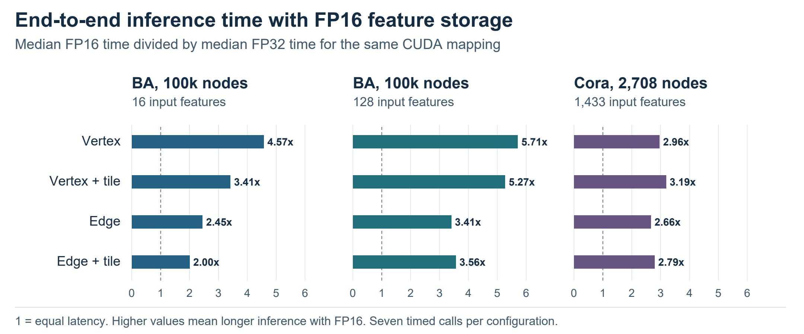

# FP32 and FP16 feature storage on the RTX 3050 Laptop GPU

FP16 saved 19.3–33.2% of total device allocation. Its median end-to-end inference time was 2.00–5.71 times the matching FP32 time across the 12 comparisons.



## Measurements

Each row compares the same graph, weights and kernel mapping. The shared-memory tile applies to the dense transform. Memory savings cover allocated device buffers. One MiB is 1,048,576 bytes.

| Graph | Input features | CUDA mapping | FP32 median (ms) | FP16 median (ms) | FP16 / FP32 | Memory saved (MiB) |
| --- | ---: | --- | ---: | ---: | ---: | ---: |
| BA-100k | 16 | Vertex | 5.52 | 25.23 | 4.57× | 6.10 |
| BA-100k | 16 | Vertex + tile | 5.79 | 19.78 | 3.41× | 6.10 |
| BA-100k | 16 | Edge | 10.97 | 26.82 | 2.45× | 6.10 |
| BA-100k | 16 | Edge + tile | 12.59 | 25.18 | 2.00× | 6.10 |
| BA-100k | 128 | Vertex | 22.99 | 131.18 | 5.71× | 48.83 |
| BA-100k | 128 | Vertex + tile | 23.13 | 121.91 | 5.27× | 48.83 |
| BA-100k | 128 | Edge | 41.60 | 141.67 | 3.41× | 48.83 |
| BA-100k | 128 | Edge + tile | 39.81 | 141.76 | 3.56× | 48.83 |
| Cora | 1,433 | Vertex | 5.84 | 17.28 | 2.96× | 14.80 |
| Cora | 1,433 | Vertex + tile | 5.65 | 18.01 | 3.19× | 14.80 |
| Cora | 1,433 | Edge | 7.28 | 19.37 | 2.66× | 14.80 |
| Cora | 1,433 | Edge + tile | 6.81 | 18.98 | 2.79× | 14.80 |

The largest latency ratio occurred on the 128-feature BA graph with the vertex mapping. On the same workload, vertex + tile reduced median kernel time from 9.52 to 6.90 ms with FP16, yet its median full-call time rose from 23.13 to 121.91 ms. End-to-end timing includes host-side packing and unpacking, transfers and synchronization. These measurements do not isolate the cost of conversion.

## Method and reproducibility

- The two Barabási–Albert workloads share the same 100,000-vertex topology, including self-loops and 1,699,928 stored CSR entries. The generator used eight edges per new vertex and seed 42. The CSR payloads at widths 16 and 128 matched byte for byte.
- Cora contains 2,708 vertices, 1,433 features and 13,264 stored entries after symmetrization and self-loop insertion. [Dataset provenance](public/cora-provenance.json)
- The eight CUDA configurations used mean aggregation, two output widths of 16 and 8, and weight seed 42. Each pair shared the same weights. Compression applied to feature storage and transfers. Weights and accumulation used FP32.
- Each configuration ran serially on the same GPU with two warmups and seven measured calls. All 24 configurations passed a separate check against sequential FP32 inference before timing. The largest absolute error for FP16 was 0.000159. The ratios divide the two seven-call medians and describe these workloads on this GPU.

[All paired metrics](comparison.csv) · [Synthetic raw samples](synthetic/raw.csv) · [Cora raw samples](public/raw.csv) · [Synthetic commands](synthetic/commands.json) · [Cora commands](public/commands.json)

To repeat the three workloads together from the repository root, supply the converted Cora file and a new output directory.

```powershell
python experiments/run_experiments.py --exe build-gpu/gnni_q1.exe --generator build-gpu/common/gnni_dataset_generator.exe --suite compression --backends cuda --public tmp/q1-data/cora.gnni --output results/compression-repeat
```
